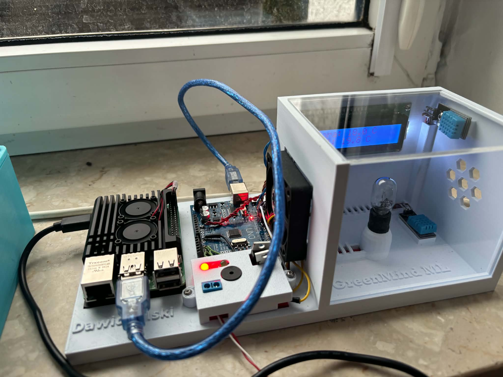
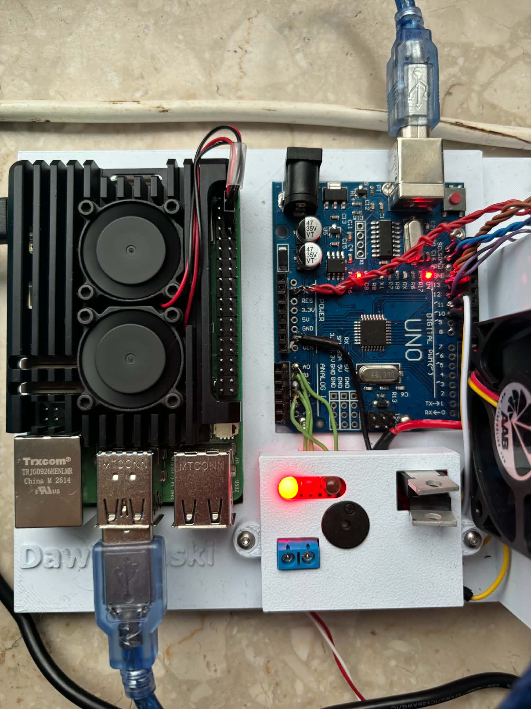
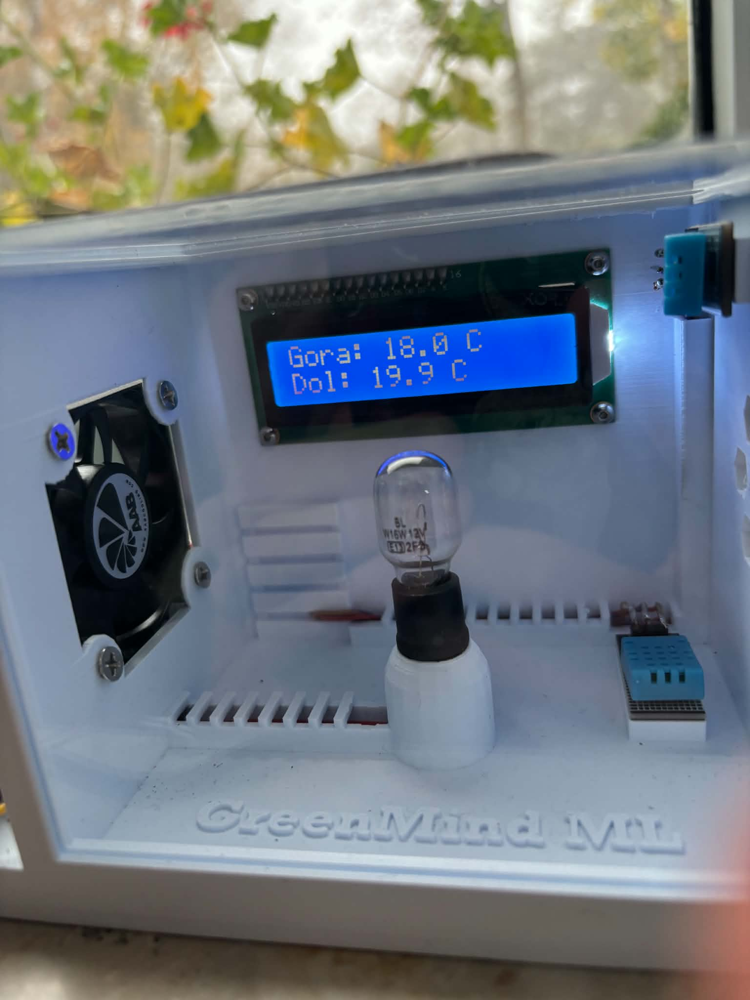
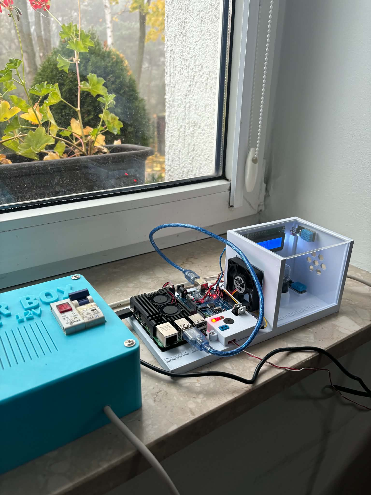
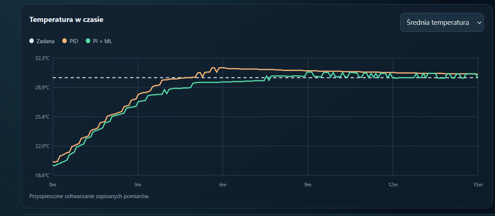
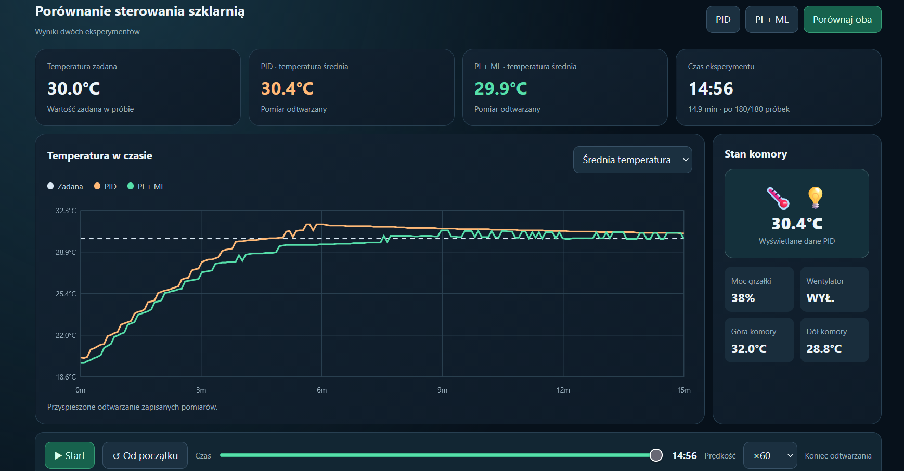
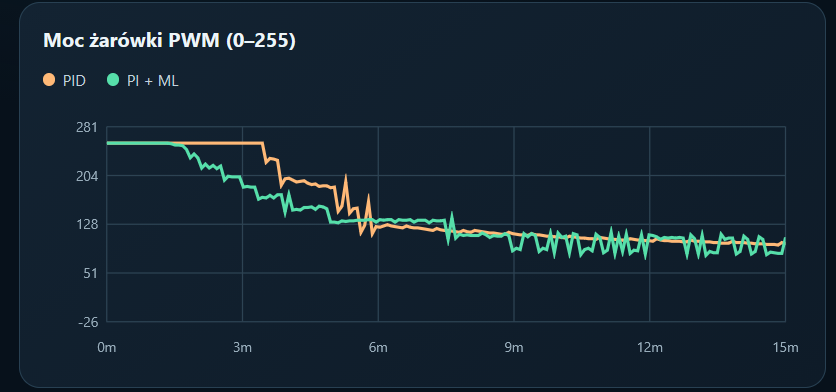
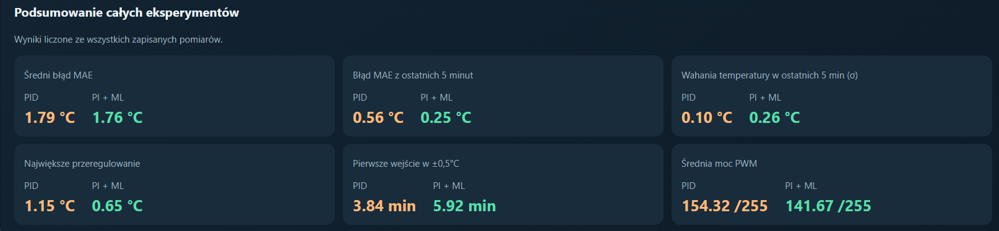

# 🌱 GreenMind ML
### Intelligent Greenhouse Temperature Control System

**Arduino • Raspberry Pi 5 • Python • Machine Learning • Control Engineering**

GreenMind ML is a practical engineering project combining **embedded systems, electronics, machine learning, and classical control engineering**.

The goal was to design and build a real miniature greenhouse, develop a model capable of predicting temperature changes, and investigate an important question:

**Can a machine-learning-assisted PI controller regulate temperature more accurately than a conventional PID controller?**

To answer this question, I built a physical experimental system, collected real sensor measurements, trained a regression model, implemented two control algorithms, and compared their performance.



---

## 🔧 Hardware & System Architecture

The experimental greenhouse consists of:

| Component | Purpose |
|---|---|
| Raspberry Pi 5 | Machine learning, data processing and control algorithms |
| Arduino | Sensor acquisition and actuator control |
| 2 × DHT11 sensors | Temperature measurement at different heights |
| 12V incandescent bulb | PWM-controlled heating |
| 12V fan | On/off ventilation |
| MOSFET circuit | Heating power control |
| USB Serial | Communication between Raspberry Pi and Arduino |

Arduino communicates with the physical components, while Raspberry Pi processes measurements and calculates control commands.

The greenhouse was designed, assembled, wired, programmed, and experimentally tested as a working hardware-software system.

### Prototype Gallery

| | |
|---|---|
|  |  |
|  |  |

---

## 🧠 Machine Learning

The ML component predicts the **average greenhouse temperature 60 seconds into the future**.

Eight experimental measurement batches were collected and processed using Python and Pandas.

The model development included:

- Feature engineering from temperature readings and operating conditions.
- Training and testing using separate experimental batches.
- Group-based cross-validation to reduce data leakage.
- Comparison of regression approaches.
- Final selection of a **Linear Regression model with StandardScaler**.
- Model serialization using Joblib.

Initially, six measurement batches were used for training and validation, while two were held out for testing. After evaluation, the final deployment model was trained using all eight batches.

The resulting model provides predictive information that can be used by the temperature controller to anticipate thermal changes.

---

## ⚙️ PID vs PI + Machine Learning

Two control strategies were implemented:

**PID — Classical Controller**

Uses proportional, integral, and derivative terms to regulate heating based on the measured temperature error.

**PI + ML — Prediction-Assisted Controller**

Combines PI control with a trained machine learning model that estimates future temperature behavior.

Both controllers were tested on the physical greenhouse with a target temperature of **30°C**.

### Experimental Results

| Metric | PID | PI + ML |
|---|---:|---:|
| Overall MAE | 1.79°C | 1.76°C |
| MAE — final 5 minutes | 0.56°C | **0.25°C** |
| Maximum overshoot | 1.15°C | **0.65°C** |
| Reaching the target region | Faster | Slower |

### Temperature Comparison



The experiments revealed two important differences:

- **PID reached the target temperature faster** and exhibited relatively small fluctuations during the final stage.
- **PI + ML achieved better average temperature tracking near the end of the experiment**, with lower maximum overshoot.

In the final five minutes, PI + ML reduced the measured mean absolute temperature error by approximately **55%** compared with PID.

These results are preliminary. The experiments had slightly different initial conditions, and further repeated tests are required before drawing general conclusions about controller performance.

### Additional Analysis

| | |
|---|---|
|  |  |
|  |  |

---

## 📊 Interactive GreenMind ML Dashboard

The project includes a custom web-based dashboard for exploring the recorded experiments.

**Main features:**

- Animated temperature charts.
- PID and PI + ML comparison modes.
- Adjustable simulation playback speed.
- PWM heating visualization.
- Fan status and sensor measurements.
- Temperature error and performance analysis.

The dashboard replays recorded CSV measurements. It does not control the physical greenhouse in real time.

### Run the Dashboard

Download the repository using **Code → Download ZIP** and extract it.

Python 3.9 or newer and a modern web browser are required. The dashboard itself uses only Python's standard library.

From the repository root, run:

**Windows:**

`python dashboard/dashboard.py`

**Linux / Raspberry Pi:**

`python3 dashboard/dashboard.py`

Then open:

**http://localhost:8765**

Select a controller and press **Start** to explore the experimental results.

No physical hardware is required for dashboard playback.

---

## 🎬 Video Demonstration

A short demonstration of the physical greenhouse and its operation.

**[▶ Watch the GreenMind ML Demonstration](videos/video.mp4)**

---

## 📁 Repository Structure

```text
GreenMind-ML/
├── arduino/
│   └── szklarnia_arduino.ino
├── controllers/
│   ├── regulator_szklarnia.py
│   └── regulator_ml_szklarnia.py
├── machine_learning/
│   ├── model_szklarnia.py
│   ├── model_lr_60s_final.joblib
│   └── data/
│       └── pomiary_TEST01-08.csv
├── dashboard/
│   ├── dashboard.py
│   ├── wyniki_pid.csv
│   └── wyniki_pi_ml.csv
├── images/
├── videos/
├── requirements.txt
└── README.md
```

The repository contains source code, an exported ML model, training measurements, experimental controller results, and visualization tools.

For the machine learning scripts, install the project dependencies using:

`python -m pip install -r requirements.txt`

The pinned dependencies reflect the Raspberry Pi development environment. The hardware controllers additionally require appropriate Arduino connections, serial port configuration, and compatible hardware.

---

## 👨‍💻 Development & AI Transparency

GreenMind ML is my independently developed engineering project.

My work included building the physical greenhouse, integrating the electronics, Arduino programming, Raspberry Pi communication, experimental data collection, machine learning development, control algorithm implementation, and performance evaluation.

**The final web visualization dashboard (`dashboard.py`) is the only component whose code was generated by AI rather than written by me.**

It was integrated into the project to make the experimental results easier to explore and present.

---

### 🌱 GreenMind ML

*Combining Machine Learning, Embedded Systems, and Control Engineering in a real physical experiment.*
